# DevSecOps Portfolio

Déploiement automatisé, API sécurisée et pipeline de contrôle continu.
**Vagrant · Ansible · Docker Compose · Next.js · Express · PostgreSQL · Jenkins**


| | |
|---|---|
| **Auteure** | Narjess Dabbech |
| **Environnement** | VM `devsecops-vm` (Ubuntu 22.04) |
| **Date** | Octobre 2026 |
| **Dépôt** | https://github.com/Narjess805/devsecops-portfolio |

## Sommaire

1. [Présentation](#présentation)
2. [Architecture](#architecture)
3. [Stack technique](#stack-technique)
4. [Structure du dépôt](#structure-du-dépôt)
5. [Environnement et prérequis](#environnement-et-prérequis)
6. [Démarrage rapide](#démarrage-rapide)
7. [11. Infrastructure (Vagrant + Ansible)](#11-infrastructure-vagrant--ansible)
8. [12. API : évolution et sécurisation](#12-api--évolution-et-sécurisation)
9. [13. Base de données PostgreSQL](#13-base-de-données-postgresql)
10. [14. Tests applicatifs](#14-tests-applicatifs)
11. [15-16. Pipeline Jenkins](#15-16-pipeline-jenkins)
12. [Synthèse sécurité](#synthèse-sécurité)
13. [Problèmes rencontrés](#problèmes-rencontrés)
14. [Pistes d'amélioration](#pistes-damélioration)

---

## Présentation

Ce projet vise un objectif simple : qu'une seule commande, `vagrant up`, produise un environnement complet, et qu'aucune version ne soit livrée sans avoir passé les contrôles de sécurité.

| Ce que le projet fait | Comment |
|---|---|
| Crée et configure l'environnement | Vagrant (provider Docker) + Ansible |
| Sert le Portfolio et l'API | Docker Compose (Next.js, Express, PostgreSQL) |
| Protège l'API | Zod, Helmet, rate limiting, erreurs centralisées |
| Stocke les messages | PostgreSQL, requêtes paramétrées, migrations Prisma |
| Contrôle la qualité et la sécurité | Jest/Supertest, Jenkins, Gitleaks, Semgrep, npm audit, Dependency-Check, Trivy |

## Architecture


## Stack technique

| Couche | Technologies |
|---|---|
| Frontend | Next.js 14 |
| API | Express, Zod, Helmet, express-rate-limit, cors |
| Données | PostgreSQL 16 (module `pg`), migrations Prisma |
| Infrastructure | Vagrant (provider Docker), Ansible, Docker Compose |
| CI/CD et sécurité | Jenkins, Gitleaks, Semgrep, npm audit, OWASP Dependency-Check, Trivy |
| Tests | Jest, Supertest |

## Structure du dépôt

```
.
├── Vagrantfile
├── inventory.ini
├── install_docker.yml            # Installation de Docker
├── install_package.yml
├── deploy_portfolio.yml          # Déploiement du Portfolio (Compose)
├── deploy_portfolio_vagrant.yml  # Variante utilisée par Vagrant
├── portfolio/
│   ├── docker-compose.yml
│   ├── frontend/                 # Next.js
│   └── api/                      # Express + Prisma
├── jenkins/
│   └── Jenkinsfile
├── captures/                     # Captures d'écran
├── .env.example
└── README.md
```

## Environnement et prérequis

| Outil | Rôle |
|---|---|
| Vagrant | Création de l'environnement |
| Ansible | Provisionnement |
| Docker et Docker Compose | Conteneurs |
| Jenkins | Intégration continue |
| Git | Versionnement |

Vérification des prérequis et des outils installés :

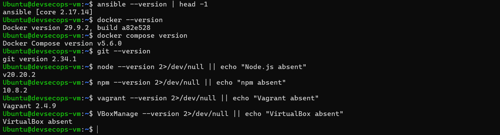

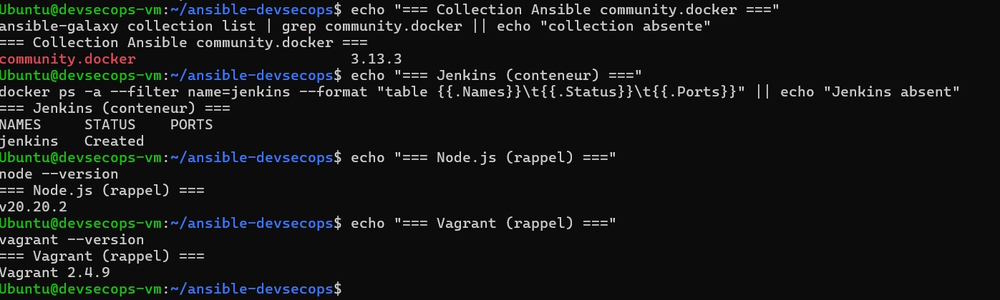

Arborescence du projet et connectivité Ansible (`ansible -m ping`) :

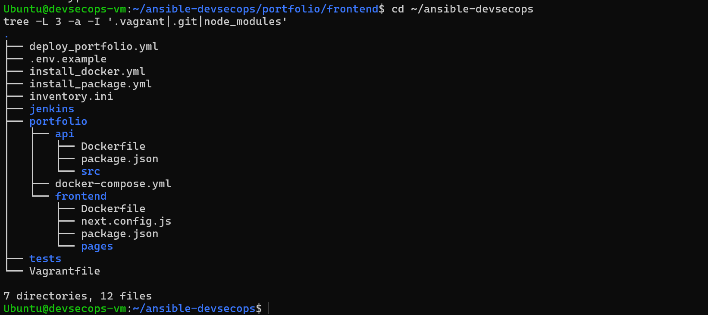

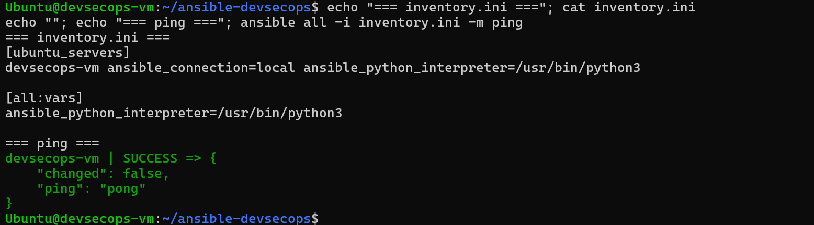

## Démarrage rapide

```bash
git clone https://github.com/Narjess805/devsecops-portfolio.git
cd devsecops-portfolio
cp .env.example .env              # puis adapter les valeurs
vagrant up --provider=docker      # création + provisionnement Ansible
```

| Service | Adresse |
|---|---|
| Portfolio | `http://192.168.56.10:3000` |
| API | port `3001` |

Commandes utiles :

```bash
cd portfolio
docker compose up -d --build      # reconstruire et relancer
docker compose ps                 # état des services
docker compose logs api --tail 30 # logs de l'API
docker compose run --rm api npm test
```

---

## 11. Infrastructure (Vagrant + Ansible)

### Q43 – Déploiement automatique du Portfolio

Le playbook `deploy_portfolio.yml` réutilise `install_docker.yml` (Q28) via `import_playbook`, puis déploie le Portfolio avec le module `community.docker.docker_compose_v2`.

```bash
ansible-playbook -i inventory.ini deploy_portfolio.yml -K
```

Résultat : `PLAY RECAP ok=16 changed=3 failed=0`. Le Portfolio est accessible sur le port 3000.

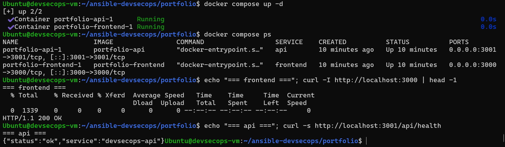

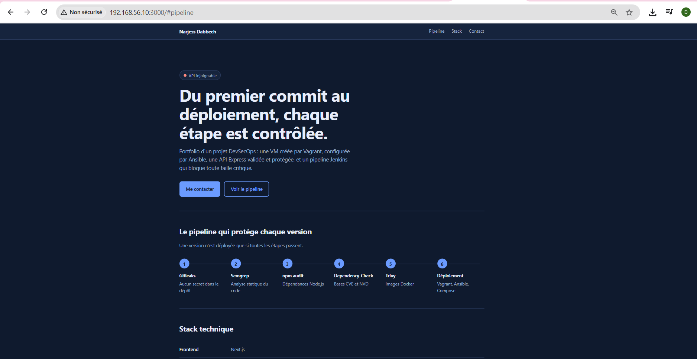

### Q44 – Automatisation complète Vagrant → Ansible

La VM n'expose pas la virtualisation imbriquée : VirtualBox est donc inutilisable. Le provider Docker de Vagrant est utilisé. La commande `vagrant up --provider=docker` crée un conteneur avec SSH et déclenche `ansible_local`.

```
vagrant up → conteneur → Ansible → installation Docker → déploiement Portfolio
```

Résultat : chaîne complète validée (`PLAY RECAP failed=0`).

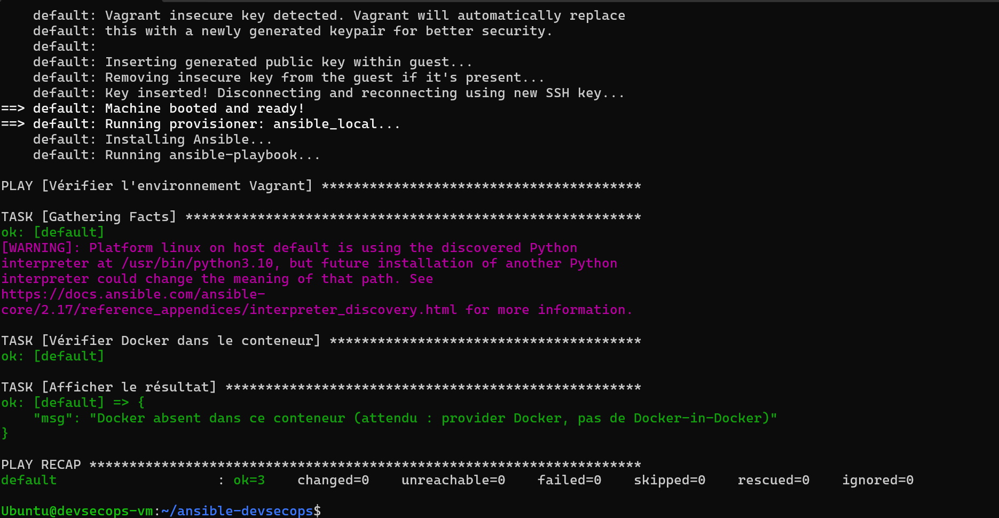

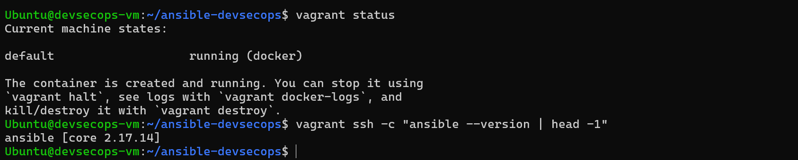

### Q45 – Test destroy / up

```bash
vagrant destroy -f
vagrant up --provider=docker
```

Le provisionnement Ansible est rejoué automatiquement et le Portfolio est redéployé sans intervention manuelle.


---

## 12. API : évolution et sécurisation

### Q46 – Route `POST /api/contact`

```bash
curl -X POST http://192.168.56.10:3001/api/contact \
  -H "Content-Type: application/json" \
  -d '{"name":"Alice","email":"alice@example.com","message":"Hello"}'
```

```json
{ "success": true, "message": "Message received" }
```

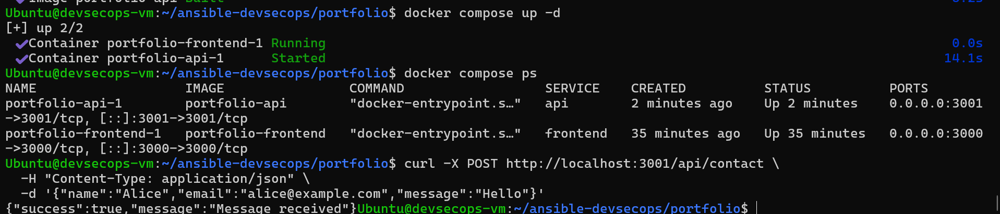

### Q47 – Formulaire Next.js connecté à l'API

Le formulaire de la page d'accueil envoie ses données avec `fetch` vers `POST /api/contact`. Le middleware `cors` est activé côté Express. Le formulaire affiche un message de succès, d'erreur de validation ou de limite atteinte (429).


### Q48 – Validation stricte avec Zod

Le schéma Zod valide `name` (2 à 100 caractères), `email` (format valide) et `message` (1 à 2000 caractères). Toute donnée invalide est refusée avec un code **400** et la liste des erreurs.

```json
{ "success": false, "errors": [{ "code": "too_small", "path": ["name"] }] }
```

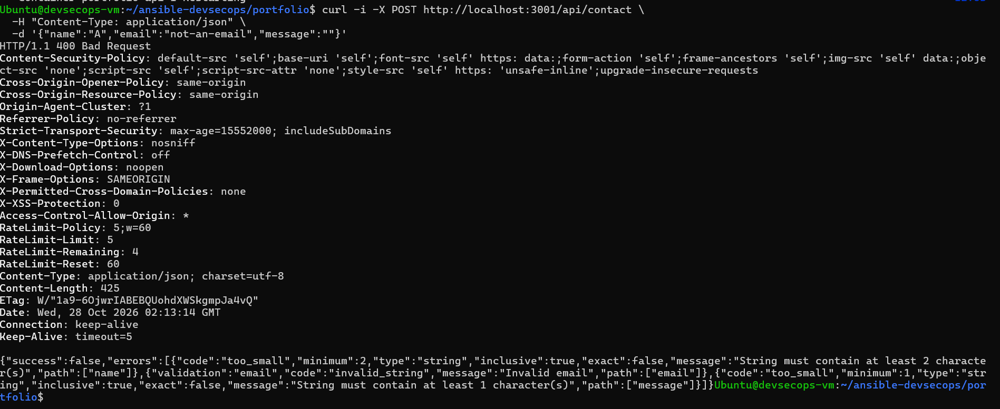

### Q49 – Gestion centralisée des erreurs

Un middleware d'erreur, déclaré après toutes les routes, renvoie un format unique sans détail interne. La route de test `/api/boom` provoque une erreur 500.

```json
{ "success": false, "message": "Erreur interne" }
```

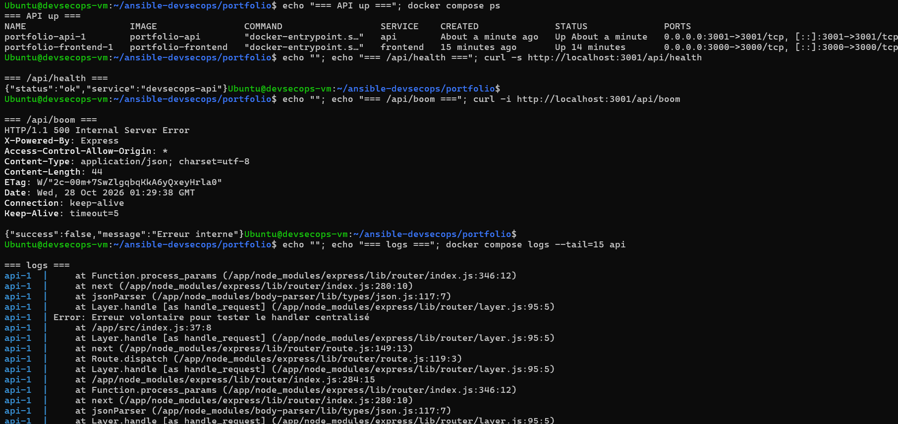

### Q50 – Headers de sécurité avec Helmet

`app.use(helmet())` ajoute CSP, HSTS et X-Frame-Options, et supprime `X-Powered-By`.

```bash
curl -I http://192.168.56.10:3001/api/health
```

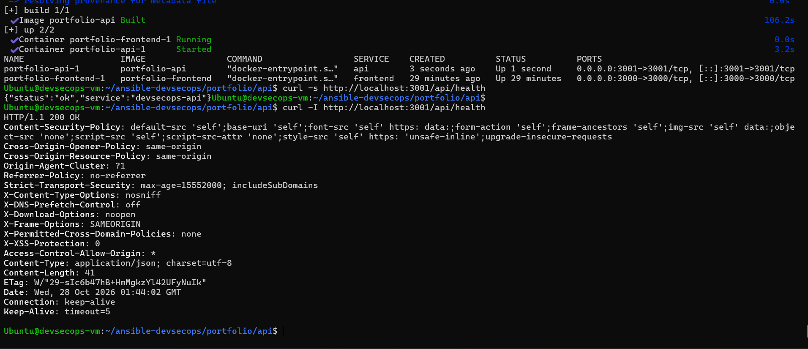

### Q51 – Rate limiting

`express-rate-limit` limite `POST /api/contact` à **5 requêtes par minute**. Au-delà, l'API répond **429 Too Many Requests**.

```
200 200 200 200 200 429 429
```

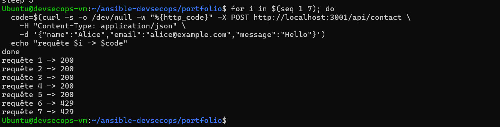

### Q52 – OWASP API Security Top 10

| Risque OWASP | Pertinence | Mesure en place / prévue |
|---|---|---|
| API1 – Broken Object Level Authorization | Faible | À implémenter lors de l'ajout de comptes |
| API2 – Broken Authentication | Élevée | JWT à ajouter pour les routes sensibles |
| API3 – Broken Object Property Level Authorization | Moyenne | Zod limite les champs acceptés |
| API4 – Unrestricted Resource Consumption | Élevée | Rate limiting (Q51) |
| API5 – Broken Function Level Authorization | Moyenne | Contrôle des rôles à prévoir |
| API6 – Unrestricted Access to Sensitive Business Flows | Moyenne | Rate limiting du formulaire |
| API7 – Server Side Request Forgery | Faible | Aucune requête sortante pilotée par l'utilisateur |
| API8 – Security Misconfiguration | Élevée | Helmet (Q50), suppression de `X-Powered-By` |
| API9 – Improper Inventory Management | Moyenne | Routes documentées dans ce README |
| API10 – Unsafe Consumption of APIs | Faible | À évaluer lors d'intégrations futures |

---

## 13. Base de données PostgreSQL

### Q53 – Service PostgreSQL

Le service `db` (image `postgres:16-alpine`) est ajouté au `docker-compose.yml`, avec ses variables d'environnement et un volume persistant.

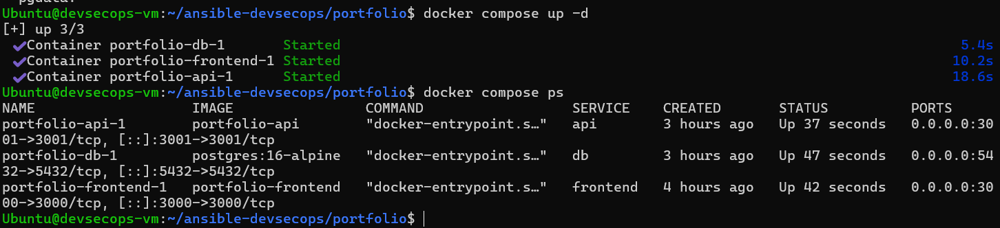

### Q54 – Enregistrement des messages

L'API utilise le module `pg` avec des **requêtes paramétrées**, ce qui empêche l'injection SQL.

```sql
INSERT INTO contacts (name, email, message) VALUES ($1, $2, $3)
```

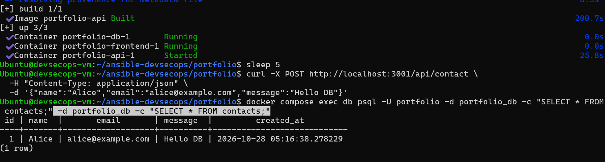

### Q55-56 – Migrations et variables d'environnement

Les migrations sont gérées par Prisma :

```bash
npx prisma migrate dev
```

Les variables de connexion sont documentées dans `.env.example` (valeur d'exemple : le vrai `.env` n'est jamais versionné) :

```env
DATABASE_URL="postgresql://portfolio:portfolio_secret@db:5432/portfolio_db?schema=public"
```

---

## 14. Tests applicatifs

### Q57-60 – Tests automatisés

Les tests s'exécutent avec Jest et Supertest dans le conteneur de l'API :

| Test | Résultat attendu |
|---|---|
| Route valide | 200 |
| Route invalide | 400 (Zod) |
| Injection SQL | Traitée comme du texte par la requête paramétrée |
| Intégration frontend → API → PostgreSQL | Message enregistré |

```bash
docker compose run --rm api npm test
```

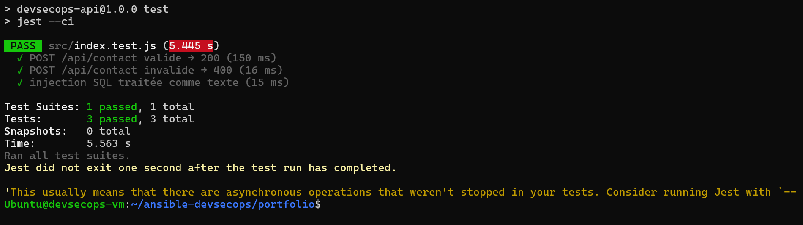

---

## 15-16. Pipeline Jenkins

Le pipeline `jenkins/Jenkinsfile` s'exécute sur le dépôt Git.

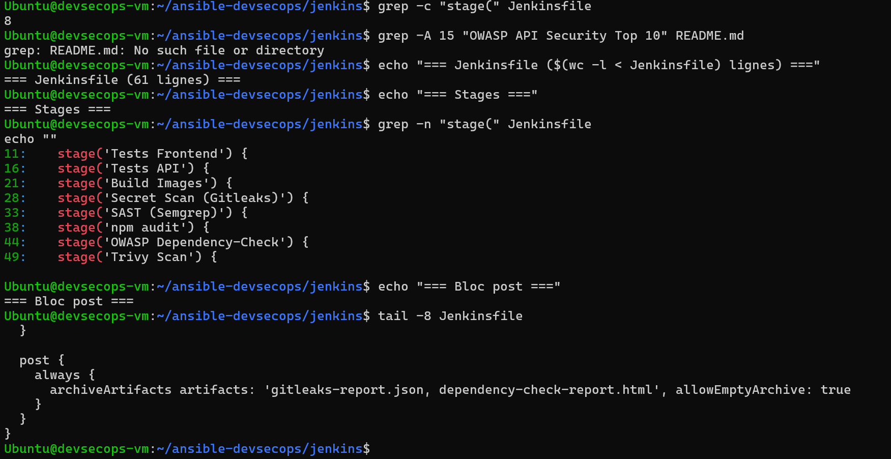

### Q61-63 – Tests, build et tag Git SHA

Le pipeline lance les tests, construit les images `devsecops-portfolio` et `devsecops-api`, puis les tague avec le SHA du commit (`${env.GIT_COMMIT.take(7)}`), par exemple `devsecops-api:a1b2c3d`.


### Q64-68 – Scans de sécurité

| Étape | Outil | Rôle |
|---|---|---|
| Détection de secrets | Gitleaks | Bloquant si un secret est trouvé |
| SAST | Semgrep | Analyse statique du code frontend et backend |
| Dépendances Node.js | npm audit | Vulnérabilités des packages |
| Analyse des CVE | OWASP Dependency-Check | Complément de npm audit |
| Images Docker | Trivy | Vulnérabilités des images |

Résultat de `npm audit` :

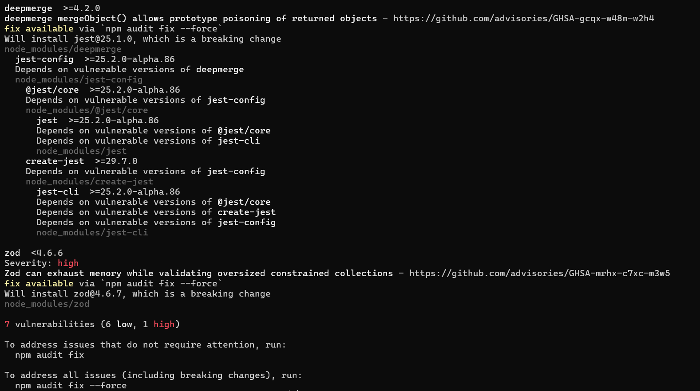

Exemple de dépendance vulnérable détectée par Dependency-Check :


### Q69 – Échec du pipeline

Le pipeline échoue si un secret est détecté ou si une vulnérabilité critique est trouvée. L'échec a été testé avec un faux secret AWS commité sur une branche de test, jamais sur `main`.

**Pipeline réussi :**


**Pipeline en échec :**


---

## Synthèse sécurité

| Domaine | Mesure |
|---|---|
| Entrées | Validation Zod stricte, requêtes SQL paramétrées |
| Exposition | Helmet, suppression de `X-Powered-By`, CORS |
| Abus | Rate limiting sur `/api/contact` |
| Erreurs | Gestion centralisée, aucun détail interne exposé |
| Secrets | `.env` ignoré par Git, Gitleaks dans le pipeline |
| Chaîne logicielle | npm audit, Dependency-Check, Trivy, pipeline bloquant |
| Traçabilité | Images taguées par Git SHA |

## Problèmes rencontrés

| Problème | Cause | Solution |
|---|---|---|
| VirtualBox inutilisable | La VM n'expose pas la virtualisation imbriquée | Provider Docker de Vagrant |
| `next build` échoue : conflit entre `pages/index.js` et `app/page.js` | Deux routeurs Next.js coexistent | Retirer l'ancienne page `pages/index.js` |
| `git push` rejeté (`fetch first`) | Le dépôt distant contenait des fichiers absents en local | `git pull --no-rebase origin main` avant de pousser |

## Pistes d'amélioration

- Authentification JWT pour les routes sensibles (OWASP API2)
- Contrôle d'accès par rôle (API5)
- Limitation par utilisateur en plus de la limitation par adresse IP
- HTTPS avec un reverse proxy devant le Portfolio et l'API
