# Activité 5 : GitHub Actions, Git workflow, images, Harbor et supply chain

Dépôt : <https://github.com/Narjess805/devsecops-portfolio>

## Sommaire de l'activité 5

- [17. GitHub Actions et sécurité GitHub](#17-github-actions-et-sécurité-github)
- [18. Git Workflow](#18-git-workflow)
- [19. Optimisation des images](#19-optimisation-des-images)
- [20. Registre privé Harbor](#20-registre-privé-harbor)
- [21. Software Supply Chain Security](#21-software-supply-chain-security)
- [Problèmes rencontrés](#problèmes-rencontrés-activité-5)
- [Synthèse](#synthèse)

---

## 17. GitHub Actions et sécurité GitHub

### Q70-71 – Workflow CI : tests, secrets, SAST, dépendances

Le workflow `.github/workflows/ci.yml` (« CI DevSecOps ») s'exécute à chaque `push` et à chaque Pull Request vers `main`. Il contient quatre jobs :

| Job | Contenu |
|---|---|
| `api-test` | Tests Jest/Supertest de l'API avec un service PostgreSQL et création de la table `contacts` |
| `frontend-test` | Tests du frontend |
| `security-scan` | Gitleaks (secrets), Semgrep (SAST, règles `p/security-audit` et `p/owasp-top-ten`), `npm audit` (dépendances) |
| `docker-build-scan` | Construction des deux images et scan Trivy (voir Q72-73) |

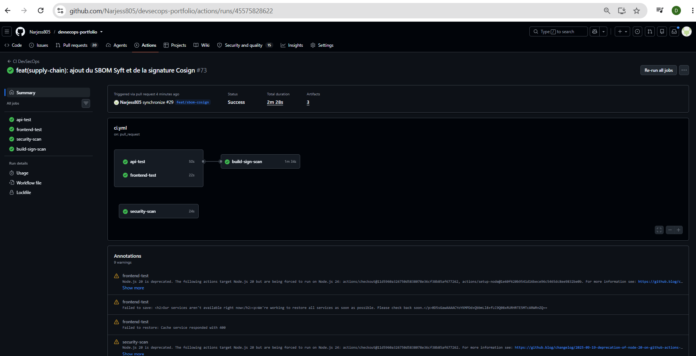

Le contrôle des dépendances a déjà joué son rôle : `npm audit` a révélé une vulnérabilité critique dans Next.js 14.2.5 (plus de 30 avis : cache poisoning, contournement d'autorisation, SSRF…) et une vulnérabilité haute dans Zod 3. Elles ont été corrigées en passant à Next 16.4.6 et Zod 4.6.7 ; l'audit indique désormais 0 vulnérabilité sur l'API et sur le frontend.

### Q72-73 – Construction des images et scan Trivy

Le job `docker-build-scan` construit les images de l'API et du frontend, les analyse avec Trivy (sévérités HIGH et CRITICAL) et publie les rapports SARIF dans l'onglet *Security*. Un second passage bloque le pipeline s'il reste une vulnérabilité CRITICAL corrigeable.

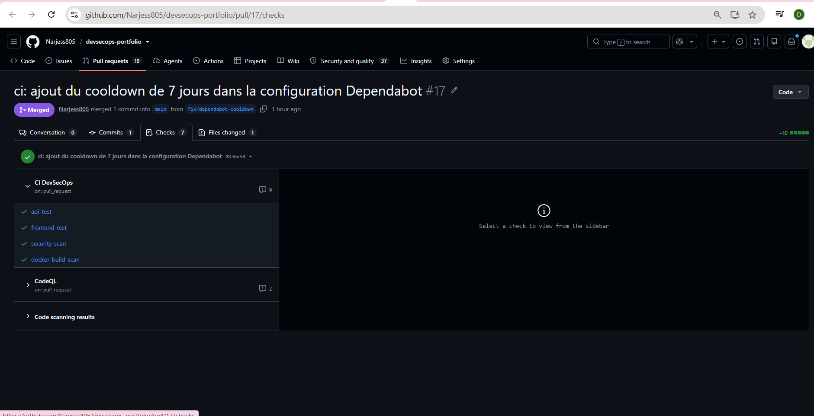

### Q74 – CodeQL et Semgrep

CodeQL (`.github/workflows/codeql.yml`, JavaScript/TypeScript) s'exécute sur chaque Pull Request. Ses résultats apparaissent dans *Security → Code scanning*.

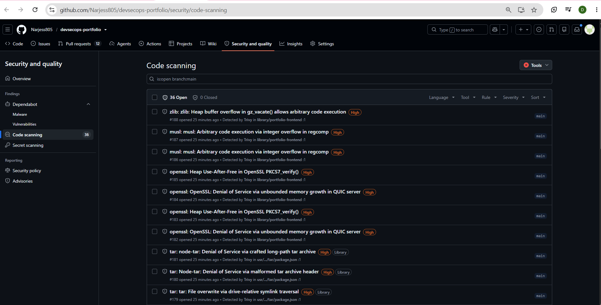

Semgrep a bloqué le pipeline avec 5 alertes, toutes sur la configuration de Dependabot :

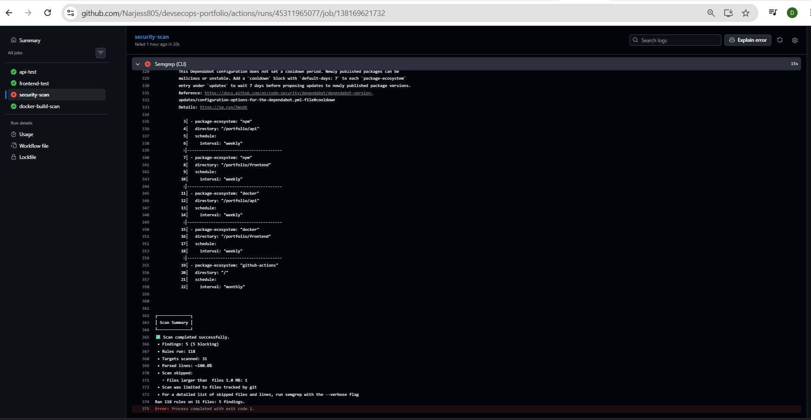

Après correction (ajout d'un `cooldown` de 7 jours à chaque entrée), le job `security-scan` passe :

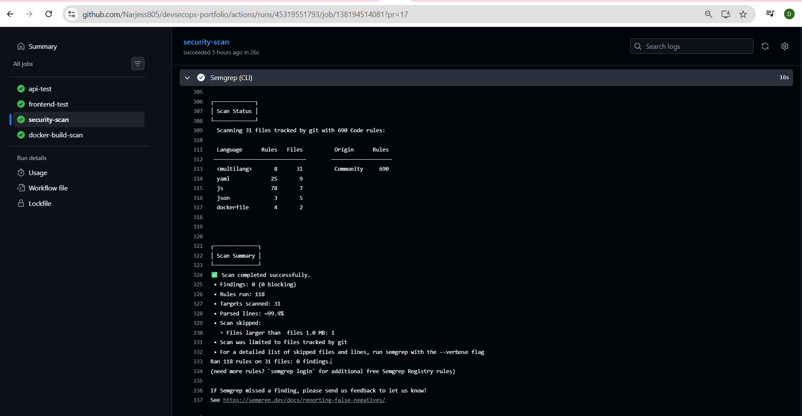

| Alerte / règle | Fichier | CodeQL | Semgrep | Commentaire |
|---|---|:-:|:-:|---|
| `dependabot-missing-cooldown` (×5) | `.github/dependabot.yml` | non | oui | Règle sur la chaîne d'approvisionnement ; les fichiers de configuration sont hors du périmètre de CodeQL. Corrigée. |
| *(à compléter avec les alertes CodeQL)* | | | | |

Aucun des deux outils n'a signalé de faille dans le code de l'API ou du frontend. Leurs périmètres diffèrent : CodeQL analyse le code JavaScript en profondeur (flux de données), Semgrep applique des règles de motifs sur le code *et* sur les fichiers de configuration (YAML, Dockerfile).

### Q75 – Dependabot

Configuré dans `.github/dependabot.yml` : npm (API et frontend), Docker (API et frontend) et GitHub Actions, avec une vérification hebdomadaire et un `cooldown` de 7 jours avant de proposer une version fraîchement publiée.

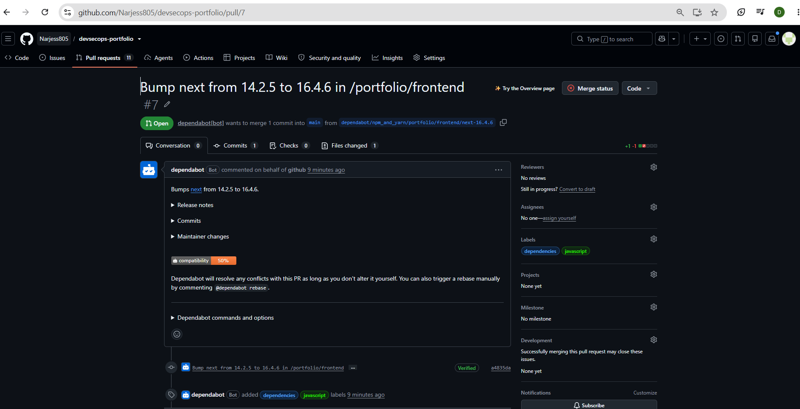

Dependabot a ouvert huit Pull Requests (#18 à #25), par exemple `express-rate-limit` 7.5.1 → 8.7.4 et `semantic-release` 25.0.9 → 26.0.1. Chacune déclenche le CI complet ; elles sont fusionnées une par une, jamais en bloc, car plusieurs sont des changements de version majeure.

### Q76 – Permissions du GITHUB_TOKEN

Chaque job déclare le strict nécessaire avec un bloc `permissions:` : `contents: read` pour les tests, `security-events: write` pour l'envoi des résultats SARIF, `contents/issues/pull-requests: write` uniquement pour le job de release.

### Q77 – Actions épinglées par SHA et surface d'attaque de la CI/CD

Les actions tierces sont référencées par le SHA complet de leur commit (par exemple `actions/checkout@11d5960a…`) et non par un tag modifiable.

**Pourquoi la chaîne CI/CD est une surface d'attaque.** Un pipeline détient des secrets, a des droits d'écriture sur le dépôt et le registre, et produit ce qui sera déployé. Compromettre une action tierce, un runner ou un workflow permet d'injecter du code dans les artefacts sans toucher au code source. Un tag (`@v4`) est déplaçable : si le dépôt d'une action est compromis, le tag peut pointer vers du code malveillant, et tous les workflows qui l'utilisent l'exécutent. Un SHA est immuable. Autres vecteurs : injection via `${{ github.event.* }}` dans un `run:`, jetons trop permissifs, runners auto-hébergés persistants.

*Limite connue :* le job `docker-build-scan` télécharge Trivy par une version fixée (`v0.69.3`) mais sans vérification de somme de contrôle. Piste d'amélioration : vérifier le hash du binaire.

### Q78 – GitHub Actions et Jenkins

| Critère | GitHub Actions | Jenkins |
|---|---|---|
| Hébergement | Runners managés par GitHub | Serveur à installer et maintenir |
| Configuration | YAML dans `.github/workflows/` | Jenkinsfile (Groovy) |
| Extensions | Marketplace d'actions (risque supply chain) | Plugins (maintenance lourde) |
| Intégration au dépôt | Native (PR, checks, code scanning) | Via plugins et webhooks |
| Secrets | Secrets GitHub, OIDC | Credentials Jenkins |
| Réseau privé | Runner auto-hébergé nécessaire | Accès direct |

---

## 18. Git Workflow

### Q79 – Stratégie de branches et convention de nommage

Flux : `branche → Pull Request → review → merge`. Convention : `<type>/<description-courte>` en minuscules avec des tirets.

| Préfixe | Usage | Exemple réel |
|---|---|---|
| `feat/` | nouvelle fonctionnalité | `feat/github-actions-devsecops` |
| `fix/` | correction | `fix/release-node22`, `fix/dependabot-cooldown` |
| `build/` | images, dépendances | `build/dockerfiles-multistage` |
| `ci/` | pipeline | `ci/activite-5` |
| `docs/` | documentation | `docs/captures-activite5` |

### Q80-81 – Protection de `main` et contrôles obligatoires

La branche `main` interdit les push directs et les force-push, et exige une Pull Request dont les contrôles `api-test`, `frontend-test`, `security-scan` et `docker-build-scan` (tests, secrets, SAST, dépendances, scan d'images) sont verts.

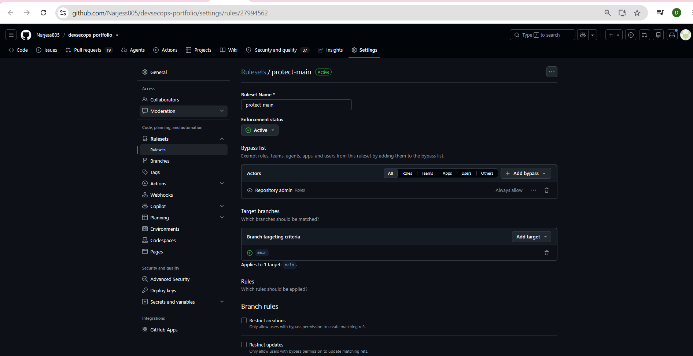

Pull Request bloquée par un contrôle en échec :

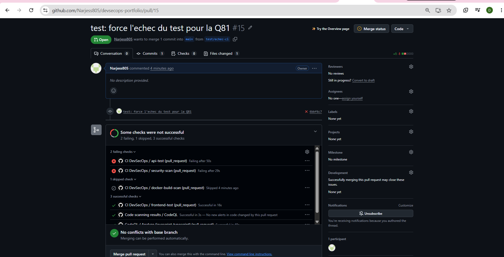

### Q82-84 – Conventional Commits, Semantic Versioning, semantic-release

Les messages suivent Conventional Commits (`feat:`, `fix:`, `ci:`, `build:`, `docs:`, `chore:`). Les versions suivent `MAJOR.MINOR.PATCH` : `fix` incrémente PATCH, `feat` incrémente MINOR, un changement incompatible incrémente MAJOR. `semantic-release` (workflow `release.yml`) calcule la version, crée le tag et publie la release GitHub avec ses notes, qui tiennent lieu de changelog.

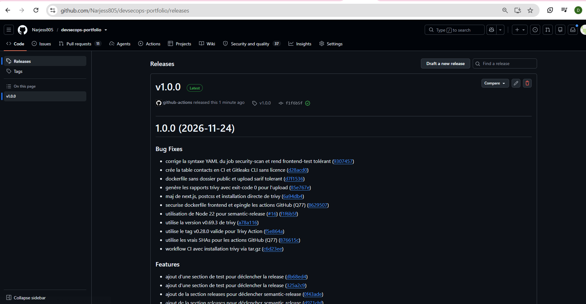

---

## 19. Optimisation des images

### Q85-87 – Avant / après

Mesures faites sur la VM, sans cache, le même jour, avec les mêmes dépendances (Next 16, Zod 4) ; vulnérabilités HIGH et CRITICAL comptées avec Trivy.

| Image | Indicateur | Avant (Dockerfile de `main`) | Après (multi-stage durci) |
|---|---|---|---|
| API | Taille | 216 Mo | 210 Mo |
| API | Temps de build | 72,6 s | 22,3 s |
| API | Vulnérabilités HIGH+CRITICAL | 29 | **7** |
| Frontend | Taille | 258 Mo | 259 Mo |
| Frontend | Temps de build | 142,3 s | 130,7 s |
| Frontend | Vulnérabilités HIGH+CRITICAL | 29 | **7** |

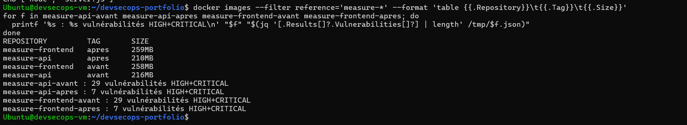

Ce qui a changé :
- Builds multi-stage : étapes `deps`, `prod-deps` (API) et `builder` (frontend), avec une image finale réduite.
- L'API n'embarque que les dépendances de production (`npm ci --omit=dev`) et s'exécute avec l'utilisateur non-root `node`.
- npm et yarn sont retirés des images finales : c'est ce qui fait passer les vulnérabilités de 29 à 7 sur les deux images (leurs dépendances internes, `tar`, `minimatch`, `glob`… étaient la source des CVE).
- Un `.dockerignore` par service : le contexte de build du frontend passe de 416 Mo à 379 Ko.
- La taille varie peu : la suppression de npm dans une couche ultérieure n'enlève pas la couche de base. Le gain porte sur la surface d'attaque.

Référence historique (état du dépôt à la fin de l'activité 4, avec Next 14 et Zod 3) : API 276 Mo, 37,9 s, 29 CVE ; frontend 223 Mo, 699 s, 48 CVE.

### Q88 – BuildKit et Buildx

Builder Buildx avec le driver `docker-container` et émulation QEMU, pour construire plusieurs plateformes :

```bash
docker run --privileged --rm tonistiigi/binfmt --install arm64
docker buildx create --name multiarch --driver docker-container --use --bootstrap
docker buildx ls
```

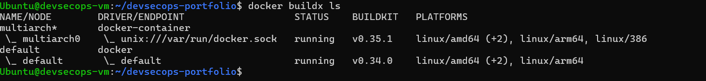

### Q89 – Image multi-architecture (amd64 et arm64)

```bash
docker buildx build --platform linux/amd64,linux/arm64 \
  -t localhost:5000/devsecops-api:multiarch --push portfolio/api
docker buildx imagetools inspect localhost:5000/devsecops-api:multiarch
```

```
Name:      localhost:5000/devsecops-api:multiarch
MediaType: application/vnd.oci.image.index.v1+json
Digest:    sha256:671e89541b939140cad5b4f42044d8a73ec87dcb69dc4764ac0a1d6134b13fa7

Manifests:
  Name:        localhost:5000/devsecops-api:multiarch@sha256:2134bbc7...d039f
  MediaType:   application/vnd.oci.image.manifest.v1+json
  Platform:    linux/amd64

  Name:        localhost:5000/devsecops-api:multiarch@sha256:8a35b4fe...d48a4
  MediaType:   application/vnd.oci.image.manifest.v1+json
  Platform:    linux/arm64

  Name:        localhost:5000/devsecops-api:multiarch@sha256:8c433629...c9268
  Platform:    unknown/unknown
  Annotations: vnd.docker.reference.type: attestation-manifest
  (un second manifeste unknown/unknown : attestation de la plateforme arm64)
```

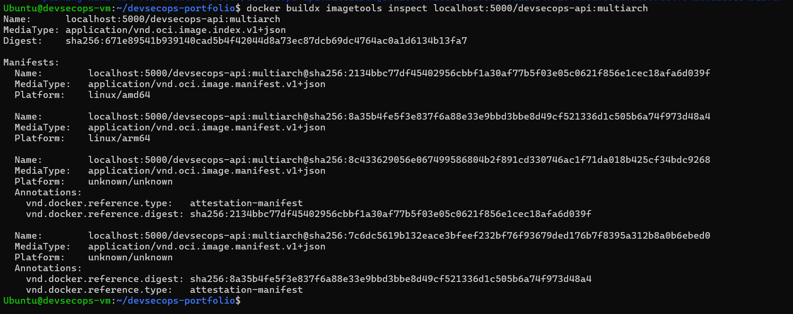

Les deux entrées `unknown/unknown` sont les attestations que BuildKit attache à chaque plateforme.

---

## 20. Registre privé Harbor

> **À compléter** : cette partie dépend de l'installation de Harbor sur la VM. Remplacer les blocs `(sortie)` par les résultats réels, ou supprimer la partie si elle n'est pas réalisée.

### Q90 – Installation

Harbor est installé avec l'installeur *offline* et le scanner Trivy intégré :

```bash
./install.sh --with-trivy
```
Interface : `http://192.168.56.10:8081`.

### Q91 – Publication depuis le pipeline

Le workflow `harbor-publish.yml` s'exécute sur un runner auto-hébergé de la VM (Harbor est sur un réseau privé) et copie l'image signée vers Harbor.

| Image | Nom complet |
|---|---|
| API | `192.168.56.10:8081/devsecops/api:<version>` |
| Frontend | `192.168.56.10:8081/devsecops/portfolio:<version>` |

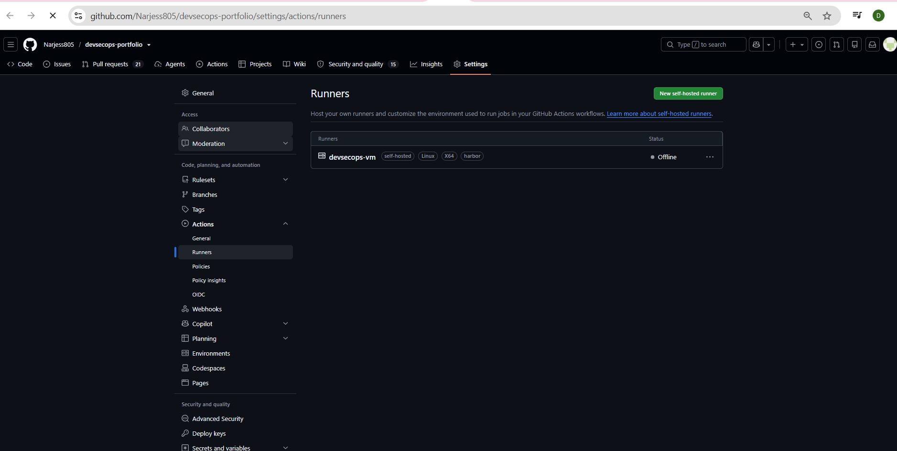
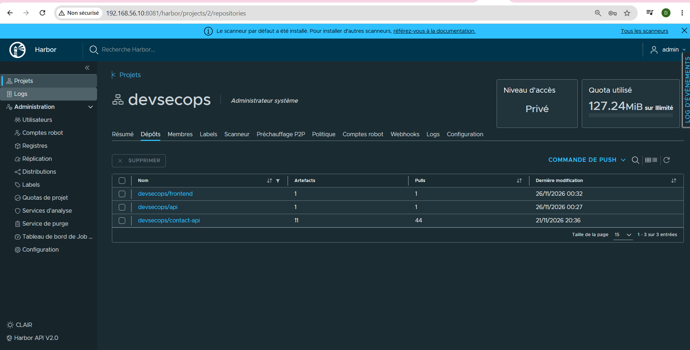

### Q92 – RBAC

Projet privé `devsecops`, utilisateur `dev-user` avec le rôle *Developer*, et un *robot account* `pipeline` limité aux droits push/pull sur ce projet.

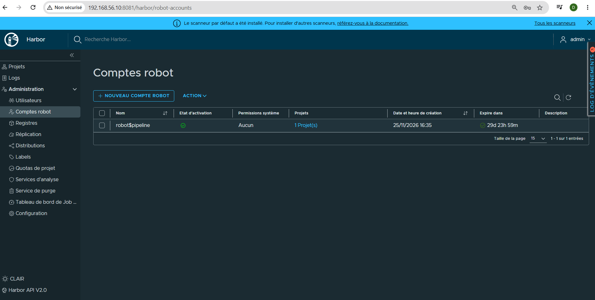

### Q93 – Scan automatique Harbor et comparaison avec Trivy

Le scan à l'envoi est activé dans la configuration du projet.

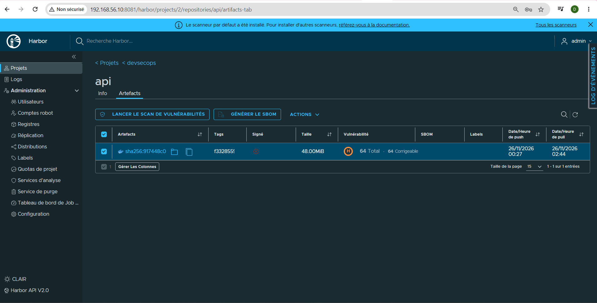

| Image | Harbor (HIGH+CRITICAL) | Trivy du pipeline (HIGH+CRITICAL) |
|---|---|---|
| API | *(à compléter)* | *(à compléter)* |

### Q94 – Politique de rétention

Règle : conserver les 10 images les plus récentes par dépôt.

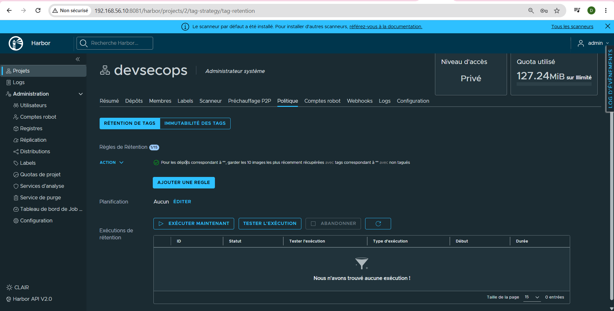

### Q95 – GitHub Container Registry et Harbor

| Critère | GHCR | Harbor |
|---|---|---|
| Hébergement | Service GitHub | Auto-hébergé |
| Intégration GitHub Actions | Native (`GITHUB_TOKEN`) | Via robot account et runner |
| Scan, RBAC, rétention | Limités | Complets, par projet |
| Réplication, quotas | Non | Oui |
| Maintenance | Aucune | À la charge de l'équipe |
| Données hors cloud | Non | Oui |

---

## 21. Software Supply Chain Security

### Q96-98 – SBOM avec Syft

Pour chaque image publiée, le workflow `publish.yml` génère un SBOM au format SPDX avec Syft, le conserve comme artefact du pipeline (90 jours) et l'attache à la release GitHub.

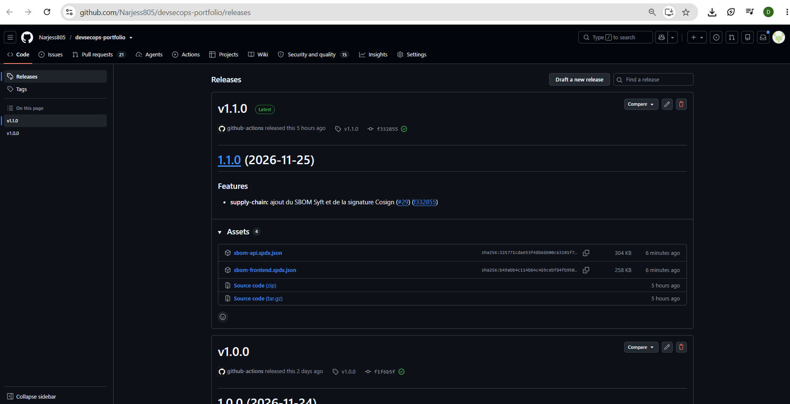
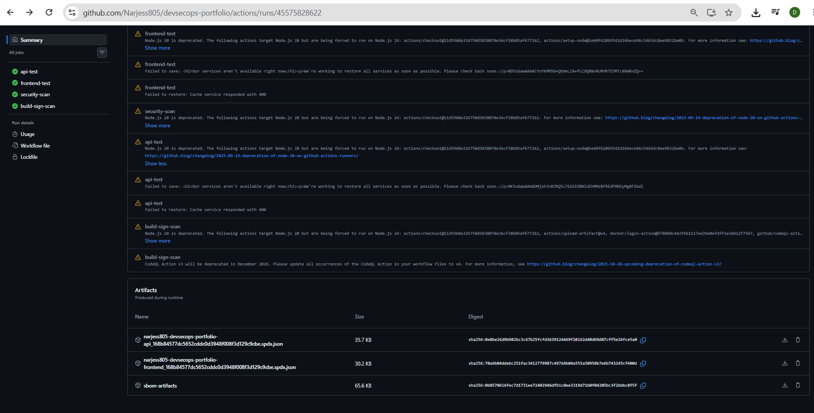

### Q99-100 – Signature et vérification avec Cosign

**Signature par clé (démonstration locale).** La clé privée n'est pas versionnée (`*.key` est ignoré par Git).

```bash
cosign generate-key-pair
cosign sign --yes --key cosign.key --tlog-upload=false localhost:5000/devsecops-api@<digest>
cosign verify --key cosign.pub --insecure-ignore-tlog=true localhost:5000/devsecops-api@<digest>
```

```
Verification for localhost:5000/devsecops-api@sha256:a7019f3b280c888c900d4f8c4a72f0130bb63e9e7a2633d0113d15c163e1c508 --
The following checks were performed on each of these signatures:
  - The cosign claims were validated
  - Existence of the claims in the transparency log was verified offline
  - The signatures were verified against the specified public key
```

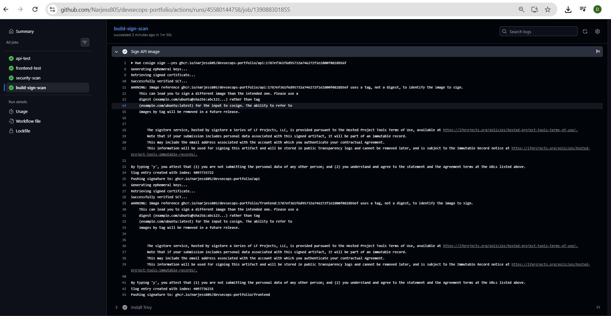

La signature porte sur le digest, immuable, et non sur un tag. Cette démonstration n'envoie pas la signature dans le journal public Rekor.

**Signature keyless dans le pipeline.** Le workflow `publish.yml` signe chaque image avec l'identité OIDC du workflow GitHub (Sigstore), sans clé à conserver :

```bash
cosign verify ghcr.io/narjess805/devsecops-api:<version> \
  --certificate-identity-regexp '^https://github.com/Narjess805/devsecops-portfolio/\.github/workflows/publish\.yml@refs/heads/main$' \
  --certificate-oidc-issuer https://token.actions.githubusercontent.com
```

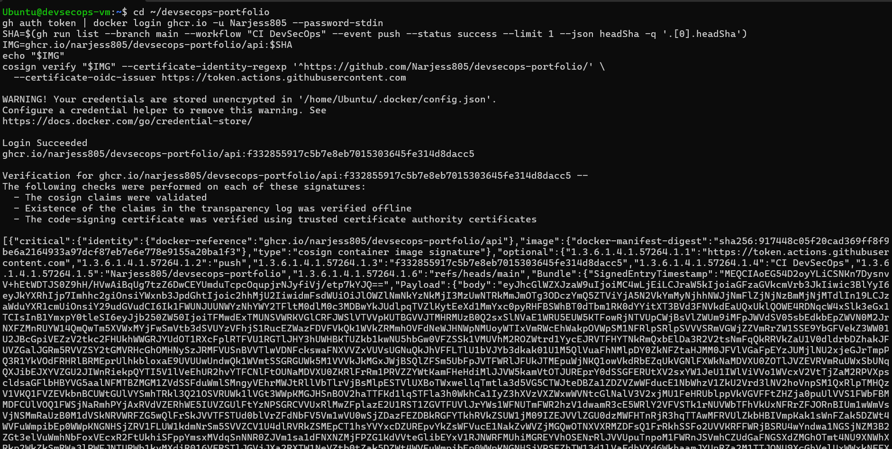

### Q101-102 – Attestations et provenance

Le workflow génère une attestation de provenance signée pour chaque image (`actions/attest-build-provenance`).

La **provenance** d'un artefact décrit d'où il vient : dépôt source, commit, workflow, builder, date. Elle permet de prouver qu'une image a été construite par *ce* pipeline à partir de *ce* commit, et non poussée à la main depuis un poste.

```bash
gh attestation verify oci://ghcr.io/narjess805/devsecops-api:<version> --repo Narjess805/devsecops-portfolio
```

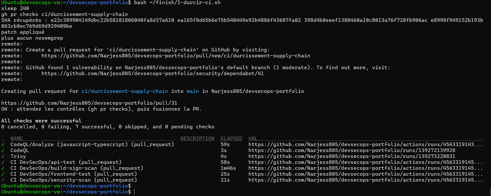
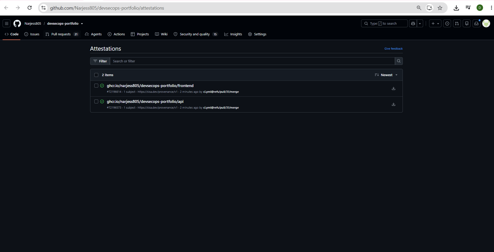

### Q103 – SLSA et in-toto

**in-toto** est un cadre qui décrit et vérifie chaque étape de la chaîne logicielle (qui a fait quoi, avec quelles entrées et sorties) au moyen d'attestations signées. **SLSA** définit des niveaux de maturité de la chaîne de build :

| Niveau | Exigence | Situation du pipeline |
|---|---|---|
| L1 | Une provenance existe | Atteint |
| L2 | Provenance signée, build sur une plateforme hébergée | Atteint (GitHub Actions et attestations signées) |
| L3 | Build isolé, provenance infalsifiable | Non atteint : pas de workflow de build réutilisable isolé |

Le pipeline se situe au niveau **SLSA Build L2**.

### Q104-105 – Refus d'une image non signée et simulation d'attaque

Le workflow `verify-image.yml` exécute `cosign verify` avant toute livraison. Sans signature valide produite par `publish.yml`, l'étape échoue et la livraison n'est jamais atteinte.

**Scénario simulé.** Un attaquant (ou une erreur) publie dans GHCR une image modifiée et non signée :

```bash
docker build -f Dockerfile.evil -t ghcr.io/narjess805/devsecops-api:malicious /tmp
docker push ghcr.io/narjess805/devsecops-api:malicious
gh workflow run verify-image.yml -f image=ghcr.io/narjess805/devsecops-api:malicious
```

**Résultat :** `cosign verify` échoue (`no signatures found`) et la livraison est bloquée.

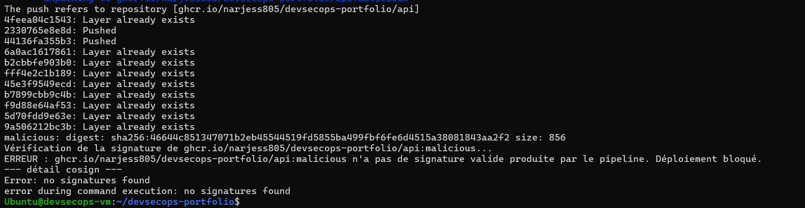

Contre-épreuve avec l'image légitime et signée :

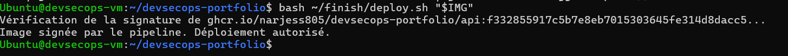

---

## Problèmes rencontrés (activité 5)

| Problème | Cause | Solution |
|---|---|---|
| `semantic-release` échoue : `node version ^22.14.0 \|\| >= 24.10.0 is required` | Le workflow utilisait Node 20 | Passage à Node 22 |
| `security-scan` bloqué par Semgrep (5 alertes) | Règle `dependabot-missing-cooldown` : aucun délai avant de proposer une version fraîche | Ajout d'un `cooldown` de 7 jours à chaque entrée |
| `npm audit` : critique sur Next 14.2.5, haute sur Zod 3 | Dépendances vulnérables | Mise à jour vers Next 16.4.6 et Zod 4.6.7 |
| Tests de l'API : `relation "contacts" does not exist` | La table n'était créée nulle part dans le dépôt | Étape de création de la table dans le job `api-test` |
| `npm ci` impossible dans le frontend | Pas de `package-lock.json` | Génération et versionnement du lockfile |
| Lockfile de l'API pointant vers un miroir npm tiers | `npm install` lancé avec un registre alternatif | URLs remises sur `registry.npmjs.org` |
| Builds interrompus : `no space left on device` | Disque de la VM saturé (caches Docker de plusieurs Go) | Suppression des caches de build et de scan |
| API : `no PostgreSQL user name specified` | Docker Compose lit `${POSTGRES_USER}` etc. et le fichier `portfolio/.env` n'existait pas | Création de `portfolio/.env` (ignoré par Git) à partir de `.env.example` |
| `git push` sur la mauvaise branche | Une branche de même nom existait déjà | Déplacement des commits vers la branche voulue |

## Synthèse

| Domaine | Mesure |
|---|---|
| Intégration continue | GitHub Actions : tests, Gitleaks, Semgrep, npm audit, Trivy |
| Analyse de code | CodeQL et Semgrep, résultats dans l'onglet Security |
| Dépendances | Dependabot (cooldown de 7 jours), `npm audit` bloquant |
| Chaîne CI/CD | Actions épinglées par SHA, `permissions:` minimales |
| Git | Branche → PR → review → merge, `main` protégée, Conventional Commits, semantic-release |
| Images | Multi-stage, non-root, sans npm, `.dockerignore`, multi-architecture |
| Registre | GHCR et Harbor (RBAC, scan, rétention) |
| Supply chain | SBOM Syft, signature Cosign, attestations, refus d'image non signée |

